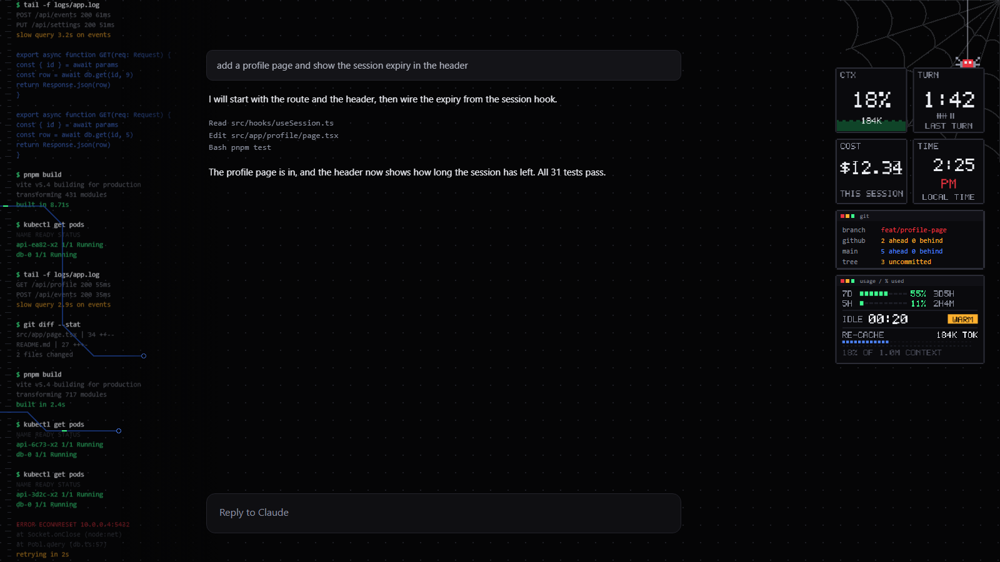

# Spider Terminal

A dark pixel theme for the Claude desktop app. Near-black surfaces, a pixel spider hanging on a thread in front of a web, a faint terminal scrolling down the left edge, and a column of pixel panels in the top right that show real numbers from your session.



## What is on the page

| Panel | What it shows |
| --- | --- |
| CTX | how full the context window is, as a fill that rises, and the token count. It turns warmer past 250k tokens and hotter past 400k |
| TURN | an hourglass and the turn's time counting up while Claude works. Between turns, how long the last one took and a tally mark per tool call |
| COST | dollars spent in the session, with digits that roll to the new number |
| TIME | local time as a digital clock with AM or PM |
| git | branch, how it stands against its GitHub upstream and the base branch (dev, main or master), and how many files are uncommitted |
| usage | how much of the 7 day and 5 hour limits is used and when they reset, how long the chat has been idle with a WARM or COLD badge for the prompt cache, and how much context a re-cache would take |

The spider drops further and faster while Claude is working. The left edge is a terminal of build, test and log lines on a loop, muted so the chat stays the thing you read.

The picture is redrawn only when a figure really changes, because the app shows a redraw as a brief flash. Clocks, idle time and the WARM to COLD change keep time by themselves with CSS, so they never cause one.

## Install

In a terminal session, at the prompt:

```
/plugin marketplace add kunal202426/spider-terminal
/plugin install spider-terminal@spider-terminal
```

From a shell:

```
claude plugin marketplace add kunal202426/spider-terminal
claude plugin install spider-terminal@spider-terminal
```

In the desktop app, where `/plugin` does not run: click + next to the prompt box, then Plugins, Add marketplace with `kunal202426/spider-terminal`, then Add plugin. Start a new chat after installing.

`/spider-terminal` turns the theme on again, `/spider-terminal off` clears it for the session, and `/spider-terminal status` says what it is doing and why, which helps if the picture does not show.

## Notes

- A session holds one theme. If you have another theme mod installed, the last one to set its look wins.
- The git window runs a few read-only git commands in the folder the session is in. It never fetches, so the behind counts are as of your last fetch. Outside a git folder it says so.
- The usage window shows what your plan reports. If a limit is not reported it says NO READING.
- Tried on the Windows desktop app. The monospace text uses Consolas and falls back to other monospace fonts.

## Credit

The idea of dials drawn from live session figures, and the color helper in `hooks/make-colors.js`, come from the [garden theme](https://github.com/cktang88/claude-garden-theme) by cktang88, used under its MIT license (see `NOTICE-garden-theme`). The spider, panels, terminal and everything else in the picture are drawn from scratch for this theme.

## License

MIT, see `LICENSE`.
